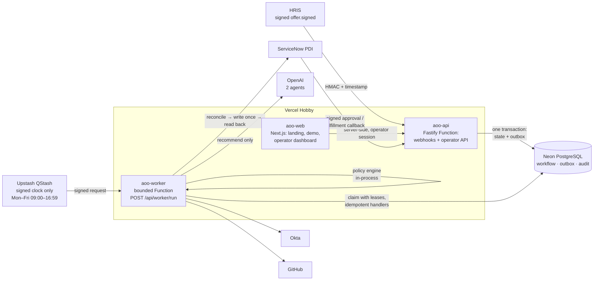
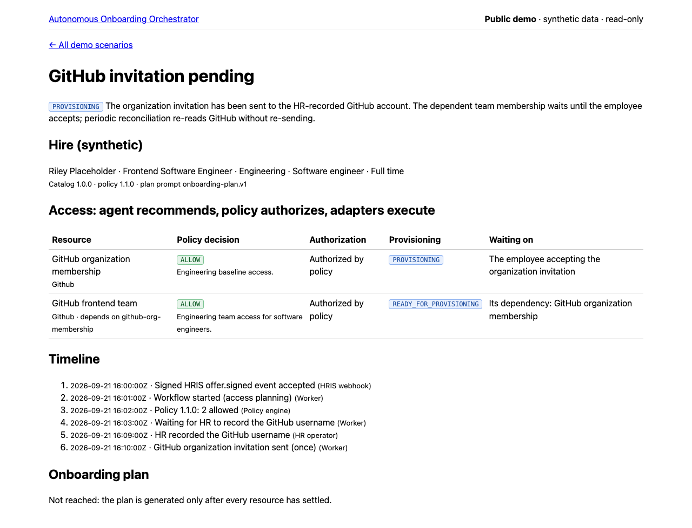

# Autonomous Onboarding Orchestrator

Event-driven employee onboarding with AI agents that only _recommend_, a deterministic policy
engine that alone _authorizes_, idempotent adapters that _execute_ against real enterprise
systems, and a durable workflow engine that _owns state_.

> **Agents recommend. Policies authorize. Adapters execute. The orchestrator owns state.**

- **Live demo (synthetic, read-only):** https://aoo-web.vercel.app/demo
- **Landing page:** https://aoo-web.vercel.app
- **Operator dashboard (internal, sign-in required):** https://aoo-web.vercel.app/admin/onboarding


## What it does

1. An HRIS sends a signed `offer.signed` event (HMAC over timestamp + raw body, 5-minute replay
   window). Only a signed offer for a cleared candidate starts onboarding.
2. The **Role Access Agent** (OpenAI, strict structured output, no tools) recommends entitlements
   from a versioned, hash-pinned resource catalog. It never sees authorization facts.
3. The **policy engine** decides every resource independently: `ALLOW`, `DENY` or
   `REQUIRES_APPROVAL`, attributable to exactly one rule, replayable forever.
4. Approval-required resources get a **ServiceNow** ticket; a human decides; ServiceNow sends a
   signed callback; the backend **reads the ticket back** and trusts only that.
5. Authorized resources are provisioned in dependency order: **Okta** group membership, **GitHub**
   organization (invitation) then team membership, **ServiceNow** fulfillment records completed
   by a human fulfiller, and operator-confirmed manual resources.
6. When everything has settled, the **Onboarding Plan Agent** writes a validated checklist that
   may reference only resources that were actually provisioned, and the workflow completes.

## Architecture



- **Modular monolith** in a pnpm + TypeScript monorepo; a custom durable workflow engine on
  PostgreSQL (state machine with optimistic locking, append-only audit, transactional outbox).
- **Outbox worker:** `FOR UPDATE SKIP LOCKED` claiming, fenced leases with heartbeat renewal,
  retries with jittered backoff, dead letters with audited redrive. The same handlers run in a
  long-lived Docker process locally and in a bounded serverless Function in production.
- **External operations:** every side effect is a durable operation with an idempotency key,
  reconcile-before-write, a single write, read-back verification and uncertain-outcome
  reconciliation (`OUTCOME_UNKNOWN` is persisted _before_ reconciling). A stale owner can never
  overwrite a newer result.
- **Agents are boxed in:** versioned prompts pinned by tests, Zod-validated outputs, post-model
  catalog validation, no tools, untrusted text fenced as data, measured by eval datasets.
- **Observability:** read-only read models, an operator dashboard with a deterministic timeline,
  opt-in OpenTelemetry with trace propagation through the outbox, request ids, correlated logs.

## Production deployment

| Piece        | Where                                            |
| ------------ | ------------------------------------------------ |
| Web          | Vercel Hobby, `apps/web` (Next.js 16)            |
| API          | Vercel Hobby, `apps/api` (Fastify Function)      |
| Worker       | Vercel Hobby, `apps/worker` (300 s Function)     |
| Database     | Neon PostgreSQL                                  |
| Scheduler    | Upstash QStash Free (signed, business hours)     |
| Integrations | ServiceNow PDI, Okta sandbox, GitHub org, OpenAI |

Vercel Hobby's Cron runs only daily, so QStash is used purely as a signed clock: it wakes the
bounded worker every minute, 09:00–16:59 Monday–Friday (America/Phoenix), i.e. 480 deliveries a
day (960 worst case with one retry, under the 1,000/day free limit). The app, API and webhooks
are available 24/7; work that arrives off-hours is committed and waits durably for the next run.
Details: [docs/DEPLOYMENT.md](docs/DEPLOYMENT.md).

## Security highlights

- Every inbound webhook is authenticated before parsing (HRIS and ServiceNow HMAC with replay
  windows; QStash JWT via the official Receiver with key rotation). Rejections write nothing.
- The operator token never reaches the browser: server-side login, then a short-lived signed
  HttpOnly / SameSite=Strict / Secure session cookie. No `NEXT_PUBLIC_*` variables, no CORS.
- Production refuses the public development defaults; secrets live only in Vercel (Production,
  Sensitive) and a git-ignored `.env`; previews receive none of them.
- Sanitized errors everywhere: no tokens, headers, query strings or provider bodies in logs,
  audit, traces or API responses.
- The public demo is synthetic, bundled, identifier-free and cannot be pointed at real data.

## Run it locally

```sh
cp .env.example .env                 # development defaults; fill in sandboxes only if you need them
docker compose up --build            # postgres, migrate, api :4000, web :3000, worker
export HRIS_WEBHOOK_SECRET=dev-only-hris-webhook-secret-change-me
pnpm hris:simulate --profile engineering
open http://localhost:3000/admin/onboarding   # operator token: ONBOARDING_ADMIN_TOKEN
```

`pnpm check` (format, typecheck, unit tests), `pnpm test:integration` (real PostgreSQL),
`pnpm build`. Live sandbox suites and the deployed end-to-end test are explicit commands listed in
[CLAUDE.md](CLAUDE.md).

## Screenshots

| Landing                                  | Demo: awaiting approval                                           | Demo: GitHub invitation pending                                           |
| ---------------------------------------- | ----------------------------------------------------------------- | ------------------------------------------------------------------------- |
|  |  |  |

Screenshots show only the public synthetic demo; no real workflow, identifier or secret appears.

## Known limitations

Demo-grade plans (Vercel Hobby, QStash Free, Neon Free); a single shared operator token (no SSO);
API tokens / Basic auth to the sandboxes; no automated remediation commands; onboarding plans are
generic (no company onboarding-module catalog). See the limitations sections in
[CLAUDE.md](CLAUDE.md) and [docs/DEPLOYMENT.md](docs/DEPLOYMENT.md).
