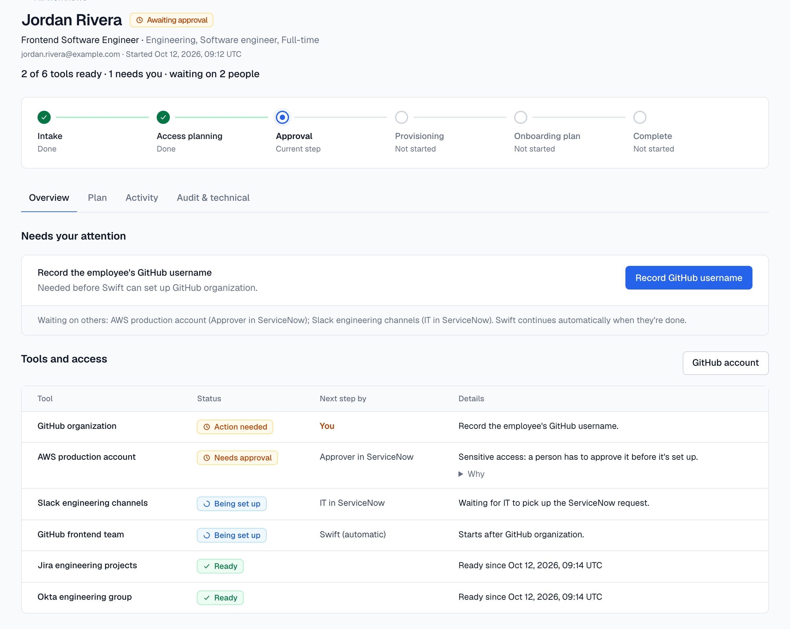
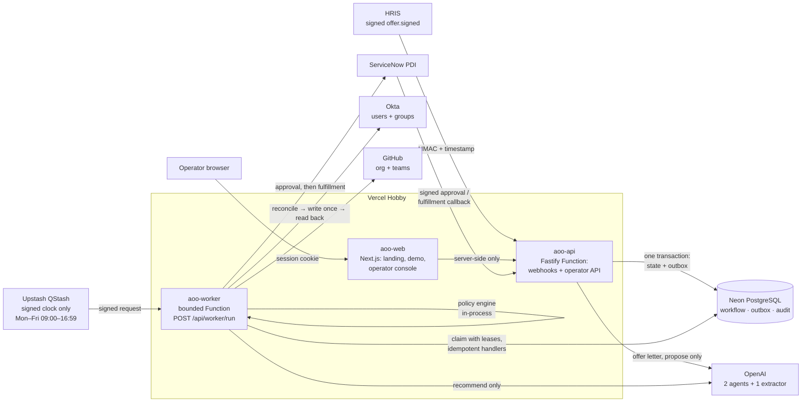
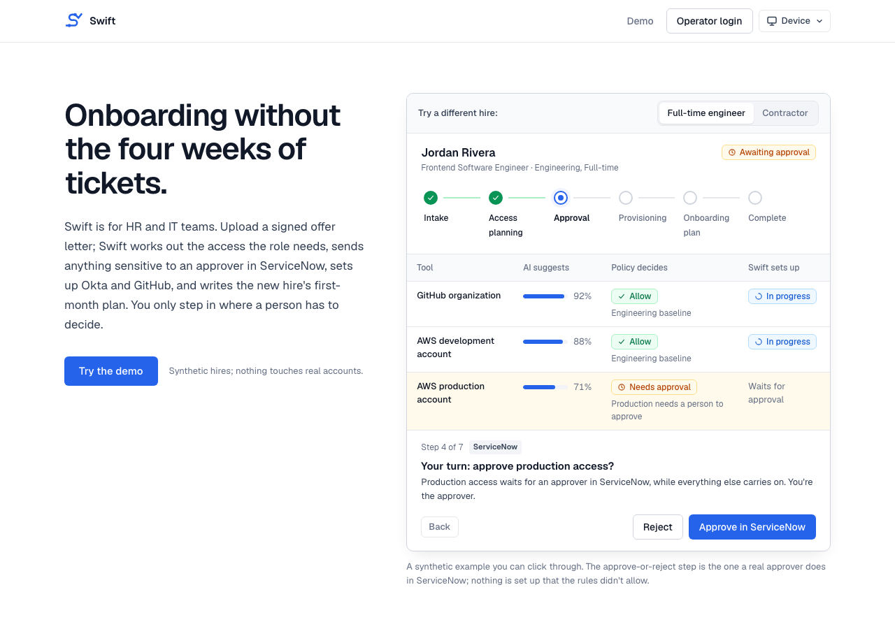
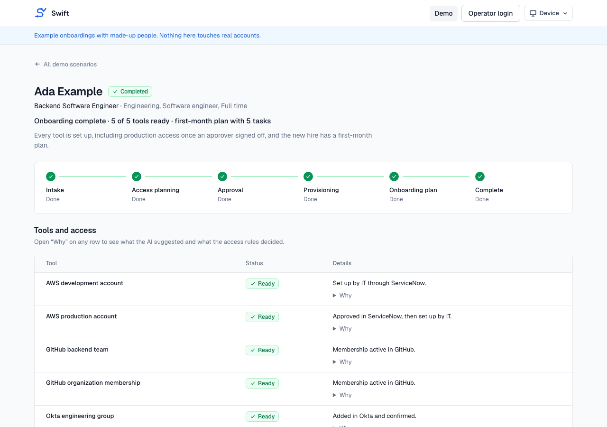
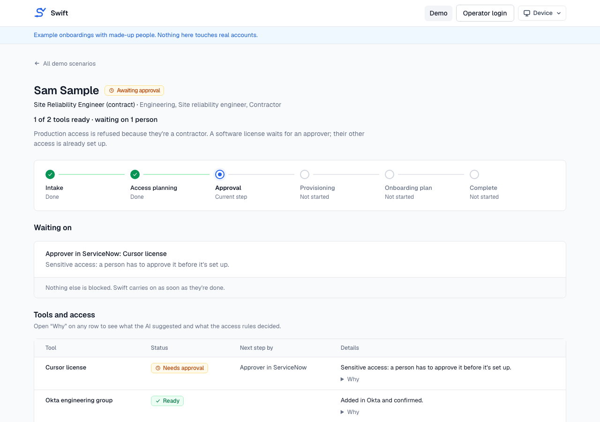

# Swift: Autonomous Onboarding Orchestrator

Event-driven employee onboarding. AI components only _propose_, a deterministic policy engine
alone _authorizes_, idempotent adapters _execute_ against real sandbox systems, and a durable
workflow engine on PostgreSQL _owns state_. People step in only where a decision needs a person:
approving sensitive access and fulfilling what can't be automated.

> **Agents recommend. Policies authorize. Adapters execute. The orchestrator owns state.**

- **Landing page:** https://aoo-web.vercel.app
- **Public demo (synthetic, read-only):** https://aoo-web.vercel.app/demo
- **Operator console (sign-up required):** https://aoo-web.vercel.app/admin/onboarding

This is a portfolio proof of concept. All people and companies in it are fabricated, every
integration is a sandbox or developer instance, and automated processing runs on a free-tier
business-hours schedule.



## What it does

1. **Intake.** Either a signed HRIS `offer.signed` event (HMAC over timestamp + raw body, 5-minute
   replay window), or an operator uploads a signed offer letter: the **Offer Letter Extractor**
   (one structured-output call, no tools) proposes display fields such as name, title and start
   date, strips compensation and personal identifiers, and never stores the PDF. The operator
   reviews every field, chooses the three canonical facts that drive access (department, role
   family, employment type) and attests the offer is signed and the candidate cleared. The AI
   never sets those facts.
2. **Recommendation.** The **Role Access Agent** (OpenAI, strict structured output, no tools)
   recommends tools from a versioned, hash-pinned catalog. It never sees authorization facts.
3. **Authorization.** The policy engine decides every tool independently: `ALLOW`, `DENY` or
   `REQUIRES_APPROVAL`, each attributable to exactly one rule and replayable from the recorded
   catalog and policy versions.
4. **Provisioning,** in dependency order, each tool on its own (catalog `1.1.0`):

   | Tool                                                 | Carried out by                                                      |
   | ---------------------------------------------------- | ------------------------------------------------------------------- |
   | Okta engineering group, Jira, Slack, AWS development | **Okta group membership, automatic** (no person involved)           |
   | AWS production                                       | **ServiceNow approval**, then a separate **ServiceNow fulfillment** |
   | GitHub organization, then team                       | **GitHub**, after HR records the hire's username                    |
   | Cursor license                                       | **The operator** (no API), confirmed in the console                 |

   Swift creates the Okta user **staged**: it never activates accounts or sets passwords. A
   ServiceNow callback is only a notification; Swift reads the ticket back and trusts only that.
   A tool becomes ready only after the provider confirms it on read-back. Onboardings keep the
   catalog version they started with.

5. **Plan.** When every tool has settled, the **Onboarding Plan Agent** writes a validated
   first-month checklist that may reference only tools the person actually has, and the
   workflow completes.

The operator console shows each hire's **start date** (with whether access is on track for it),
**how long access took** (onboarding start → every tool settled), **how long the whole
onboarding took** (start → plan written), and per tool, **how long after the start it became
ready**, all from durable timestamps. Operators can **retry** a failed tool (fresh provider
operations, history kept) and **request a new approval** when ServiceNow confirms the old ticket
no longer exists.

## Architecture



- **Modular monolith** in a pnpm + TypeScript monorepo, with a custom durable workflow engine on
  PostgreSQL: a state machine with optimistic locking, an append-only audit log and a
  transactional outbox (a state change and its events commit together).
- **Outbox worker:** `FOR UPDATE SKIP LOCKED` claiming, fenced leases with heartbeat renewal,
  retries with jittered backoff, dead letters with audited redrive. The same handlers run in a
  long-lived Docker process locally and in a bounded serverless Function in production.
- **External operations:** every side effect is a durable operation with an idempotency key:
  reconcile before writing, write once, verify by read-back, and persist `OUTCOME_UNKNOWN` before
  reconciling an uncertain result. A stale owner can never overwrite a newer result, so replays
  and duplicate deliveries never repeat a side effect.
- **AI is boxed in:** versioned prompts pinned by tests, Zod-validated outputs, post-model
  catalog validation, no tools, untrusted text fenced as data, and evaluation datasets run
  against the real model (including prompt-injection cases).
- **Observability:** read-only read models, an operator console with a deterministic timeline,
  opt-in OpenTelemetry with trace propagation through the outbox, request ids, correlated logs.

## Production deployment

| Piece        | Where                                            |
| ------------ | ------------------------------------------------ |
| Web          | Vercel Hobby, `apps/web` (Next.js 16)            |
| API          | Vercel Hobby, `apps/api` (Fastify Function)      |
| Worker       | Vercel Hobby, `apps/worker` (300 s Function)     |
| Database     | Neon PostgreSQL                                  |
| Scheduler    | Upstash QStash Free (signed, business hours)     |
| Integrations | ServiceNow PDI, Okta sandbox, GitHub org, OpenAI |

Vercel Hobby's Cron runs only daily, so QStash is used purely as a signed clock: it wakes the
bounded worker every minute, 09:00–16:59 Monday–Friday (America/Phoenix), i.e. 480 deliveries a
day (960 worst case with one retry, under the 1,000/day free limit). The app, API and webhooks
are available 24/7; work that arrives off-hours is committed and waits durably for the next run.
Details: [docs/DEPLOYMENT.md](docs/DEPLOYMENT.md).

## Security highlights

- Every inbound webhook is authenticated before parsing (HRIS and ServiceNow HMAC with replay
  windows; QStash JWT via the official Receiver with key rotation). Rejections write nothing.
- Operators sign in with their own accounts (scrypt hashes, generic failures, lockout after 5
  attempts, server-side logout). The browser only holds a short-lived signed HttpOnly /
  SameSite=Strict / Secure session cookie; the server-to-API credential never reaches it. No
  `NEXT_PUBLIC_*` variables, no CORS.
- Least privilege in every provider: the ServiceNow integration account can only create and read
  requests, and the fulfiller role can change one field.
- Production refuses the public development defaults; secrets live only in Vercel (Production,
  Sensitive) and a git-ignored `.env`; previews receive none of them.
- Sanitized errors everywhere: no tokens, headers, query strings or provider bodies in logs,
  audit, traces or API responses.

## Run it locally

```sh
cp .env.example .env                 # development defaults; fill in sandboxes only if you need them
docker compose up --build            # postgres, migrate, api :4000, web :3000, worker
export HRIS_WEBHOOK_SECRET=dev-only-hris-webhook-secret-change-me
pnpm hris:simulate --profile engineering
open http://localhost:3000/admin/onboarding/signup   # create a local operator account
```

`pnpm check` (format, typecheck, 844 unit tests), `pnpm test:integration` (380 tests against real
PostgreSQL), `pnpm build`. Live sandbox suites, evaluations and the deployed end-to-end test are
explicit commands listed in [CLAUDE.md](CLAUDE.md), which also holds the architecture decisions
and the verification record of every milestone.

## Screenshots

Public, synthetic pages only. The demo scenarios predate catalog `1.1.0`, so they still show AWS
development fulfilled through ServiceNow.

| Landing                                  | Demo: completed                                   | Demo: awaiting approval                                           |
| ---------------------------------------- | ------------------------------------------------- | ----------------------------------------------------------------- |
|  |  |  |

## Known limitations

- Demo-grade hosting (Vercel Hobby, QStash Free, Neon Free): automated work runs on weekday
  business hours only.
- Okta accounts stay staged; activation on the start date isn't implemented.
- The GitHub sandbox has a single test account, so only one hire can be linked to it; others stop
  safely with an ownership error.
- No SSO or roles: anyone can sign up and every account is a full operator, bounded by daily
  limits (a proof-of-concept choice).
- API tokens / Basic auth to the sandboxes; no offboarding or role changes; onboarding plans are
  generic (no company onboarding-module catalog).

See the limitations sections in [CLAUDE.md](CLAUDE.md) and [docs/DEPLOYMENT.md](docs/DEPLOYMENT.md).
